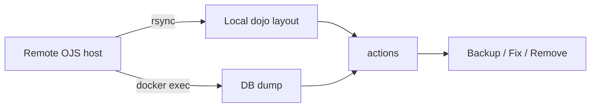

# serverScripts

Bash toolkit for common tasks that are not yet relevant enough to move into the "dojo" project.
Tasks include rsync OJS between local and remote servers, DB dumps (now moved to dojo), data removal, zfs management, and running same actions across all instances.
Targets OJS instances need to be running under Docker, with optional ZFS snapshot support.

## What it does

<i class="fa-solid fa-server"></i> Connects to remote OJS hosts and syncs data locally.
<i class="fa-solid fa-database"></i> Dumps, restores and fixes OJS databases.
<i class="fa-solid fa-box-archive"></i> Backs up full instances, data or DB only.
<i class="fa-solid fa-broom"></i> Removes data or entire instances cleanly.
<i class="fa-solid fa-hard-drive"></i> Manages ZFS snapshots and volumes.
<i class="fa-solid fa-list-check"></i> Runs the same action across all instances.

## Flow



## Layout

```text
serverScripts/
├── actions/         Reusable composite actions
├── configs/         Host and environment configuration
├── dbFix/           Database fixes and patches
├── dbRun/           Query and migration runners
├── remoteServer/    Remote connection logic
├── zfs/             ZFS snapshot and volume helpers
├── jBackup.sh       Full instance backup
├── jDumpDB.sh       Database dump
├── jRunSQL.sh       Run SQL against an instance
├── jDataRemove.sh   Remove instance data
├── jFullRemove.sh   Remove entire instance
├── mDelDB.sh        Drop database
├── mFixLinks.sh     Fix links after migration
├── mSpaceUsage.sh   Disk usage report
├── dTransferImage.sh Transfer images between environments
├── runForAll.sh     Run an action across all instances
├── hProxyTest.php   HTTP proxy test
└── justfile         Task orchestrator
```

## Requirements

<i class="fa-brands fa-linux"></i> Bash 4+
<i class="fa-solid fa-network-wired"></i> `rsync`, `ssh`
<i class="fa-brands fa-docker"></i> `docker` and `docker compose`
<i class="fa-solid fa-hard-drive"></i> `zfs` (optional)
<i class="fa-solid fa-terminal"></i> [Just](https://github.com/casey/just)

## Usage

```bash
# List available tasks
just --list

# Run a task
just backup
just dumpdb <instance>
just runforall <command>
```

## License

GNU General Public License v3. See `LICENSE`.
